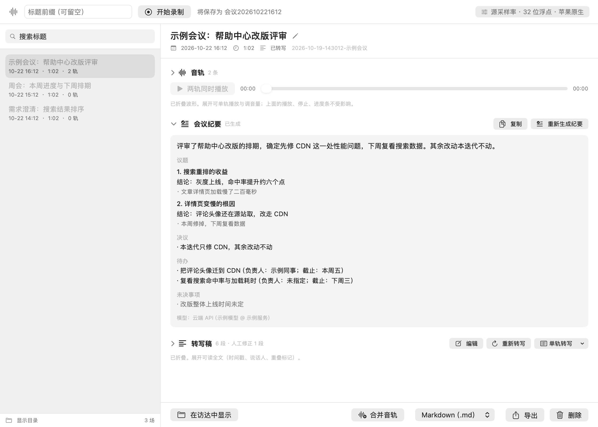

# 会议录音器（MeetingRecorder）

macOS 上的本地会议录音工具：**双轨录音 + 本机转写 + 会议纪要**。会议内容默认不出本机。

[English](README.en.md) · [简体中文]



---

## 它解决什么问题

线上会议有三件事一直很别扭：

1. **录下来也分不清谁说的。** 大多数工具只给一个混音文件，事后听到两个人同时说话就断了线索。
2. **转写要上传。** 云端转写服务便宜好用，但会议内容往往是最不该外流的那类文本。
3. **录完没人整理。** 一段两小时的录音，真正有用的结论可能只有五条。
4. **录着音不想被看见。** 共享屏幕或同事路过时，菜单栏的计时和红点都很显眼；可为了藏起来就不录，代价更大。

这个工具对这四件事各做一个决定：

| 问题 | 做法 |
|---|---|
| 分不清谁说的 | **双轨录制**：「我」= 本机麦克风，「对方」= 系统音频输出。说话人身份由**音轨**决定，不做声纹分离 |
| 转写要上传 | 用 macOS 原生语音识别，**在设备上**转写，音频不出本机 |
| 录完没整理 | 在转写稿之上加一层**会议纪要**：默认本机模型，也可接自备的云端 API |
| 录着音不想被看见 | **录音状态可以不显示**：录制时只留中性图标（不计时、不变红），或把菜单栏图标整体关掉。此时靠**全局快捷键**控制——⌥⌘R 开始 / ⌥⌘P 暂停 / ⌥⌘S 停止 / ⌥⌘M 显示窗口 |

它的产物是一堆普通文件（`manifest.json` / `mic.wav` / `system.wav` / `transcript.md`），
没有数据库，可以直接拷走、`grep`、丢进任何备份方案。

---

## 功能

- **双轨录制**：麦克风与系统音频各写一条 WAV，时间轴按 `hostTime` 对齐，两轨可同时播放、各自调音量
- **崩溃可恢复**：录制期间每 5 秒落盘一次检查点，异常退出后 `mr recover` 能扫回来
- **本机转写**：默认识别中文/英文等 30 种语言，长音频直转（实测约 160 倍实时）
- **可选更强的引擎**：SenseVoice（opt-in，需下载约 244 MiB 模型），专有名词密集的场景更稳
- **会议纪要**：把转写稿整理成「议题 → 结论 / 决议 / 待办 / 未决事项」，并标出它纠正了哪些识别错误
- **转写稿可编辑**：逐段修正或清空，改过的段落留痕（原稿与新稿都在）
- **体积可控**：16 位整数、单声道 24 kHz 两个开关叠加后约为原始体积的 1/6
- **菜单栏常驻**：录制中显示计时，可一键进入「静默录制」（只留中性图标、不计时、不变红），
  也可以把菜单栏图标整体关掉——**录音本身不受影响**。两项开关在「设置（⌘,）→ 通用 → 菜单栏」
- **全局快捷键**：⌥⌘R 开始 / ⌥⌘P 暂停 / ⌥⌘S 停止 / ⌥⌘M 显示窗口，任何程序在前台都生效。
  录音状态被隐藏时这四个键照常可用，所以「不让别人看见」不会变成「自己也控制不了」；
  组合被别的程序占用时会直接报出来，不会静默失效
- **导出**：Markdown / 纯文本 / 双轨合并成单个立体声文件（我 = 左，对方 = 右）

---

## 系统要求

- **macOS 26.0 或更高**（转写依赖系统语音识别框架，本地纪要依赖 FoundationModels）
- Apple Silicon 或 Intel Mac（**仅在 Apple Silicon 上实测过**，见「已知限制」）
- 构建需要 Xcode 命令行工具（Swift 5.9+）
- 首次录制需要授权两项系统权限：**麦克风**、**屏幕与系统音频录制**

---

## 构建与安装

```bash
git clone https://github.com/mybigbag/MeetingRecorder.git meeting-recorder
cd meeting-recorder

# 1. 编译并打包成 .app（脚本自己会先跑 swift build -c release）
./scripts/build-app.sh

# 2. 启动
open MeetingRecorder.app
```

`build-app.sh` 会把 `.app` 放在仓库根目录，并按当前时间自动更新版本号（格式 `MAJOR.YYYYMMDD.HHMM`）。
只想编译不打包：`swift build`。

> **为什么要打包成 `.app` 才能用**
> 系统音频捕获（Core Audio Process Tap）的权限是按「bundle 身份」记账的。
> 直接跑 `.build` 里的裸二进制拿不到权限，而且失败是**静默的**：
> 所有 API 都返回成功、采样点数完全正确，缓冲区里全是零。
> 仓库根的 `./mr` 是一个转发脚本，它转调的就是 `.app` 里的那个二进制。

构建失败提示 `sandbox-exec: Operation not permitted` 时，给 `swift build` / `swift test` 加 `--disable-sandbox`。

### 命令行入口

```bash
./mr doctor      # 能力自检：权限、引擎、设备是否就绪
./mr --help      # 全部命令与选项
```

想在任何目录直接敲 `mr`：

```bash
ln -s "$(pwd)/mr" /usr/local/bin/mr
```

---

## 快速开始

### 图形界面

1. 双击 `MeetingRecorder.app`（菜单栏出现图标）
2. 在输入框里填一个会议标题（可留空，会自动生成），点「开始录制」
3. 会议结束点「停止」；也可以随时暂停/继续
4. 在左侧列表里点开这场会议：音轨、会议纪要、转写稿三栏，按需展开
5. 没有转写稿时点「重新转写」；想生成纪要再点「生成纪要」


默认只展开「会议纪要」，音轨与转写稿折起来——开会时你最常看的是结论，
要核对原话时再展开。

### 命令行

```bash
# 录制（Ctrl-C 停止）
./mr record --title "产品评审会"

# 转写（会话 ID 从 list 里取，也可以直接给目录）
./mr transcribe 2026-10-19-143012-产品评审会

# 转写 + 顺带生成纪要
./mr transcribe 2026-10-19-143012-产品评审会 --minutes

# 看看都录了什么
./mr list
```

---

## 存储布局

每场会议一个目录，默认在 `~/Documents/MeetingRecorder/`（用 `--root` 可改）：

```
~/Documents/MeetingRecorder/
└── 2026-10-19-143012-产品评审会/
    ├── manifest.json      这场会议的全部元数据（时间、设备、格式、暂停、状态）
    ├── mic.wav            「我」轨：本机麦克风
    ├── system.wav         「对方」轨：系统音频输出
    ├── transcript.md      转写稿（给人看，带时间戳与说话人）
    ├── transcript.json    转写稿（给程序读）
    ├── minutes.md         会议纪要（给人看）
    └── minutes.json       会议纪要（结构化）
```

`samples/` 下有一份**格式示例**（内容是编的，只用来对照字段）。

`manifest.json` 是这场会议的唯一事实来源：删掉转写稿不会影响音频，
删掉 `minutes.json` 只会让纪要需要重新生成。

---

## 会议纪要

纪要默认由**本机模型**生成，转写稿不出本机。本机未启用 Apple Intelligence 时，
它会明确降级为「只保留原文」，而不是假装生成了一份纪要。

想用更强的模型，可以接一个 **OpenAI 兼容**的云端接口（DeepSeek、GLM、Qwen、Kimi 等）：

```bash
./mr config set minutes api
./mr config set minutes-url https://api.deepseek.com/v1
./mr config set minutes-key sk-...
./mr config set minutes-model deepseek-chat
```

也可以在「设置（⌘,）→ 会议纪要」里填，并点「测试连接」当场验证（只发一句固定短句，不碰会议内容）。

> **这是隐私决策，不是性能开关。** 选了 `api`，转写稿就会发往你填的那个地址。
> 密钥只存在本机偏好域（UserDefaults），界面、日志与 `config show` 一律打码，
> 不会写进 `minutes.md` / `minutes.json`，也不会随纪要请求发出去。


---

## 隐私

- **无账号、无服务器、无遥测。** 这个工具不做任何回连。
- **音频与转写稿默认只在本地。** 转写走系统语音识别框架，在设备上完成。
- **云端是可选的，且必须自己配。** 三项（URL / 模型名 / 密钥）缺任何一项，
  生成纪要会**在写任何文件之前**报错并列出要敲的命令，不会静默回退到本地、
  也不会产出一份署名不同的稿子。
- **删除走废纸篓。** 清理旧音频只删 `.wav`，`manifest` 与转写稿都保留。

---

## 命令参考

| 命令 | 用途 |
|---|---|
| `mr record` | 双轨录制（`--title` / `--seconds` / `--pcm16` / `--mono24k` / `--root`） |
| `mr transcribe <会话>` | 转写；`--track mic\|system` 只转一条轨，`--minutes` 顺带出纪要 |
| `mr minutes <会话>` | 为已转写的会议生成纪要 |
| `mr list` | 列出所有会议 |
| `mr devices` | 列出音频输入设备（含 UID，用于 `--device` 锁定） |
| `mr recover` | 扫描并修复崩溃残留的录音 |
| `mr doctor` | 能力自检：权限、引擎、设备 |
| `mr transcode <会话>` | 把已有音频转成更小的格式（`--all` 批量，`--dry-run` 只算账） |
| `mr merge <会话>` | 两条轨道合成一个立体声文件（我 = 左，对方 = 右） |
| `mr prune` | 按保留策略清理旧音频（唯一会删数据的命令，默认只预演） |
| `mr config` | 查看/修改全局配置（引擎、纪要模型层、保留策略、菜单栏图标…） |
| `mr model` | 管理 SenseVoice 资产（下载 / 校验 / 删除） |
| `mr version` | 打印版本号 |

完整选项与设计取舍都在 `./mr --help` 里——它写得比多数 README 长，因为每条选项背后
都对应一个「不写清楚就会做错决定」的场景。

**几个容易踩的点：**

```bash
# 转写引擎是全局设置，不是每场勾选
./mr config set engine sensevoice
./mr model download          # 首次使用该引擎需要资产（约 244 MiB）

# 「设保留档位」和「执行清理」是两个动作：
# 设档位不会删任何东西，它只决定「什么时候有人来清」
./mr config set retention 30
./mr prune --dry-run          # 先看看会删几场、多少体积
./mr prune --yes              # 真的清
```

---

## 开发

### 模块划分

| 模块 | 职责 |
|---|---|
| `MRCore` | 纯逻辑：WAV、时间轴、manifest、转写稿结构、保留策略。零系统依赖，可在无权限环境完整测试 |
| `MRCapture` | Core Audio 集成：麦克风 + 系统音频 Process Tap，写盘与崩溃检查点 |
| `MRTranscribe` | 转写引擎（系统语音识别 / SenseVoice）与资产管理 |
| `MRMinutes` | 纪要层：分块、map-reduce 编排、降级、云端 API 客户端 |
| `MRSession` | 跨入口共享的编排层，CLI 与 GUI 都调这里 |
| `MRCLI` | 命令行前端：参数解析与终端输出 |
| `MRGUI` | SwiftUI + AppKit：主窗口、菜单栏、设置窗口、播放器 |
| `MeetingRecorderMain` | 唯一持有 `@main` 的入口分派（带参数走 CLI，不带参数弹窗口） |

### 测试

```bash
swift test                  # 全量（约 1300 条）
swift test --filter MRCoreTests
```

测试分层与项目本身的取舍一致：**能纯逻辑测的绝不拖到界面**。
音频链路（时间轴、WAV、崩溃恢复）在 `MRCoreTests` 里用合成数据跑，
不需要任何权限；界面里值得单测的只有两类——播放器状态机，以及
「开关失效时界面上看不出异常」的那些（比如静默录制的计时）。

### 界面复核

界面改动不能只看断言。`scripts/probes/` 下每个探针都把**生产视图**装进真实
`NSWindow`，用 `cacheDisplay(in:to:)` 离屏抓成 PNG，交给人眼看：

```bash
swift build
./scripts/probes/readme-shots/run.sh        # 本文档里的三张图就是这样生成的
./scripts/probes/settings-window-render/run.sh
./scripts/probes/meeting-detail-render/run.sh
```

它们不需要屏幕录制权限，也不碰真实会议库（临时目录 + 独立偏好域）。
不用 `ImageRenderer`：含 `ScrollView` 的视图离屏不布局，会画出整块空白，
而尺寸断言照样全绿——这个坑踩过两次。

---

## 已知限制

这些是实测得出的边界，不是待办清单：

- **只支持 macOS 26 及以上。** 转写与本地纪要依赖的系统框架在此之前的版本里不存在。
- **只在 Apple Silicon 上实测过。** 代码没有故意依赖架构，但 Intel 机器没有验证过，
  尤其系统音频捕获部分。
- **本机没启用 Apple Intelligence 时，纪要会降级成「只有原文」。** 这是预期行为，
  界面上会有明确标注，不会给你一份看不出问题的空纪要。
- **状态栏图标必须由系统启动方式打开。** 直接执行 `.app` 里的二进制会让系统
  **永久**拒绝登记这个应用的状态栏项（图标再也出不来）。从访达或 `open` 启动即可；
  程序里也做了交接，但绕过它的方式没有好处。
- **不做说话人分离。** 「谁说的」由音轨决定，所以只适用于「一台电脑 + 外放/耳机」的会议。
  一个房间里三个人共用一台麦克风时，三个人都会被记成「我」。
- **「对方」轨依赖系统音频捕获。** 有些设备/驱动下这条轨可能采到静音，
  `mr doctor` 会打印真实采集到的采样值来区分「没声音」与「没权限」。
- **长音频不分段。** 实测单段直转两小时音频只用 56 秒、内存恒定 24 MB，
  分段反而慢 5 倍。`--segment` 保留给「某段失败不能拖垮整条轨」的场景。

---

## 许可

[MIT](LICENSE)
